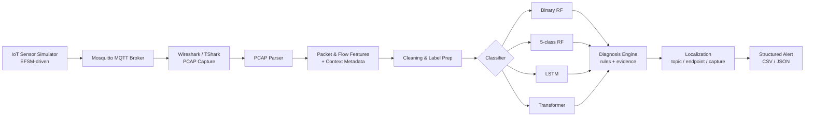

<div align="center">

# 🛡️ Attack Diagnosis and Localization in IoT Intrusion Detection
### Using Formal Modeling and Deep Learning

*Detect it. Classify it. Explain it. Locate it.*


**B.Tech Final Year Project · Dept. of CSE · Prasad V. Potluri Siddhartha Institute of Technology, Vijayawada**

</div>

---

## 📖 Table of Contents

- [Overview](#-overview)
- [Highlights](#-highlights)
- [System Architecture](#-system-architecture)
- [Two Experimental Paths](#-two-experimental-paths)
- [Results](#-results)
- [Diagnosis and Localization](#-diagnosis-and-localization)
- [Repository Structure](#-repository-structure)
- [Getting Started](#-getting-started)
- [Usage](#-usage)
- [Testing](#-testing)
- [Limitations](#-limitations-read-before-citing-results)
- [Future Work](#-future-work)
- [Team](#-team)
- [References](#-references)

---

## 🔎 Overview

Most IoT Intrusion Detection Systems answer one question: *"Is this traffic malicious?"*
Security teams also need to know **what mechanism is involved** and **where it is happening**.

This project builds a software-based research prototype that extends a formal-modeling-assisted, deep-learning IDS with a transparent **diagnosis and localization layer**. It combines:

- **Formal behaviour models** (EFSMs for temperature and motion sensors)
- **MQTT traffic simulation** with four controlled attack-like scenarios
- **Packet feature extraction** from PCAP captures (including inter-arrival time)
- **Classifiers:** binary and five-class Random Forest, plus LSTM and Transformer sequence models
- **A rule-assisted diagnosis engine** that outputs structured evidence and context-based localization

> The project follows the broad direction of *Kaddoura et al. (2026)*, who use formal modeling and mutation testing to generate IoT attack data. Results published in that paper are **not** reused here. All numbers below were measured in this implementation.

---

## ✨ Highlights

| | |
|---|---|
| 📦 **Dataset** | 42 PCAP captures → **2,985,994** packet rows (IAT-enriched) |
| 🏆 **Best model** | Five-class Random Forest: **93.41% accuracy, 0.8959 macro-F1** |
| 🧪 **Tests** | **42 passed** in 8.93 s |
| 🩺 **Diagnosis records** | 47 unified records (42 external captures + 5 local MQTT captures) |
| 🧩 **Formal models** | Temperature and motion EFSMs with guards, counters and anomaly states |
| 🔍 **Honest reporting** | Limitations and non-comparable metrics are explicitly documented |

---

## 🏗️ System Architecture



---

## 🔀 Two Experimental Paths

The project has two related but **separate** paths. They answer complementary questions and should not be treated as one dataset.

### Path 1: External dataset (ML evaluation)

42 public PCAP captures with filename-derived classes.

| Class | Packets |
|---|---:|
| benign | 137,396 |
| dos | 141,709 |
| mirai | 2,202,225 |
| mitm | 194,184 |
| scan | 310,480 |
| **Total** | **2,985,994** |

**Features:** packet length, inter-arrival time (IAT), rolling 10-second packet rate, TCP SYN / ACK / RST flags, UDP length.

### Path 2: Local MQTT simulation (diagnosis demo)

Normal traffic plus four controlled scenarios generated through Mosquitto:

| Scenario | What the script does | Caveat |
|---|---|---|
| **Replay-like** | Repeats the same payload multiple times | Legitimate sensors can repeat values |
| **Data falsification** | Publishes extreme values (85, −20, 95, 0, 90) | Uses illustrative bounds of −10 °C to 60 °C |
| **MITM-like** | Publishes original and altered (+15 °C) values on original/forwarded topics | Topic-level simulation, not a real network-path MITM |
| **Battery-draining-like** | Publishes 100 QoS-1 messages at 0.05 s intervals | Measures publish rate, not physical battery drain |

---

## 📊 Results

### Model comparison

| Model | Task level | Accuracy | Macro-F1 | Weighted F1 |
|---|---|---:|---:|---:|
| Binary Random Forest | Packet · benign vs attack | 96.08% | n/a | n/a |
| **Five-class Random Forest** | Packet · 5 classes | **93.41%** | **0.8959** | **0.9345** |
| LSTM | Sequence (20 packets) | 65.62% | 0.4131 | 0.6854 |
| Transformer | Sequence (20 packets) | 64.43% | 0.3697 | 0.6384 |

> ⚠️ **These rows are not directly comparable.** The binary model solves a different task, and the sequence models use a different split whose test set contains **no benign or MITM sequences**.

### Per-class metrics

<details>
<summary><b>Click to expand the full per-class table</b></summary>

| Model | Class | Precision | Recall | F1 | Support |
|---|---|---:|---:|---:|---:|
| RF binary | benign | 0.409 | 0.980 | 0.577 | 3,600 |
| RF binary | attack | 0.999 | 0.960 | 0.979 | 128,332 |
| RF 5-class | benign | 0.592 | 0.951 | 0.730 | 3,000 |
| RF 5-class | dos | 0.932 | 0.972 | 0.951 | 10,000 |
| RF 5-class | mirai | 0.988 | 0.990 | 0.989 | 40,000 |
| RF 5-class | mitm | 0.896 | 0.970 | 0.932 | 30,000 |
| RF 5-class | scan | 0.965 | 0.805 | 0.878 | 28,966 |
| LSTM | dos | 0.900 | 0.780 | 0.836 | 11,962 |
| LSTM | mirai | 0.655 | 0.494 | 0.564 | 11,962 |
| LSTM | scan | 0.652 | 0.681 | 0.666 | 17,943 |
| Transformer | dos | 0.654 | 0.243 | 0.354 | 11,962 |
| Transformer | mirai | 0.569 | 0.916 | 0.723 | 11,962 |
| Transformer | scan | 0.891 | 0.680 | 0.772 | 17,943 |

*Benign and MITM have zero support in the LSTM/Transformer test sets.*

</details>

### Capture-level evaluation

A capture is labelled **attack** if at least **50%** of its packets are predicted as attack.

| Metric | Value |
|---|---|
| Captures evaluated | 42 (1 benign, 41 attack) |
| Capture-level accuracy | 100% (confusion matrix `[[1, 0], [0, 41]]`) |
| Benign capture false-positive rate | 1.8% of packets (`benign-dec.pcap`) |
| Weakest attack capture | `mitm-arpspoofing-4`, 69.02% of packets flagged |
| Next weakest | `scan-portos-6`, 91.37% flagged |
| All other attack captures | above 98% of packets flagged |

> ⚠️ This evaluation covers **all 42 captures, including captures used for training**, so it shows pipeline behaviour, not generalization to unseen networks.

### Model and data details

| Item | Value |
|---|---|
| 5-class RF sample | 401,401 rows → 289,435 train / 111,966 test |
| RF capture split | 30 attack captures train / 11 attack captures test |
| LSTM sequences | 247,008 total → 169,255 train / 35,886 val / 41,867 test |
| LSTM input | 20-packet sequences × 7 features |
| Transformer parameters | 67,781 |
| Saved RF model size | 75.18 MB (`models/rf_5class.joblib`) |
| Training hardware | CPU only |

### Key takeaways

- 🥇 The **Random Forest is the strongest current model**, and it beats both sequence models on the reported metrics.
- 📉 **Scan** is the hardest RF class (recall 0.805).
- 🎯 **Benign** has high recall but low precision, because the dataset has only **one benign capture**.
- 🔧 The sequence models need a class-complete, capture-grouped evaluation before any conclusion about deep learning can be drawn.

---

## 🩺 Diagnosis and Localization

| Stage | Question answered |
|---|---|
| **Detection** | Is the traffic suspicious? |
| **Classification** | What category is it? |
| **Diagnosis** | What evidence explains the mechanism? |
| **Localization** | Which device, topic or flow is involved? |

### Diagnosis signals

| Signal | Interpretation | Caution |
|---|---|---|
| Out-of-range sensor value | Data-falsification evidence | Thresholds are configuration-specific |
| High rolling publish rate | Excessive communication / battery-draining-like | Rate does not prove battery depletion |
| Repeated payload | Replay-like evidence | Stationary sensors may repeat legitimately |
| Original vs forwarded mismatch | Message-manipulation evidence | Topic-level simulation is not a full MITM |
| Topic / endpoint / capture mapping | Localization context | May be missing or spoofable |

### Design principles

- Repeated normal readings alone are **never** enough to declare an attack.
- Malformed or missing payloads are handled safely.
- IAT and payload size alone **cannot** identify a physical device.
- When context is missing, the system reports **unknown / ambiguous** rather than inventing a location.

---

## 📁 Repository Structure

```
iot-ids-diagnosis/
├── captures/          # PCAP captures and traffic mapping
├── diagnosis_loc/     # Diagnosis and localization logic
├── docs/              # Documentation, architecture, demonstration_plan.md
├── features/          # Feature extraction and datasets
├── ids/               # Baseline RF and LSTM / Transformer models and evaluation scripts
├── models_fsm/        # Temperature and motion EFSM definitions and scenario mapping
├── results/           # Metrics (JSON/CSV), confusion matrices, diagnosis records
├── simulation/        # Simulated IoT devices, MQTT traffic and attack scenarios
├── .gitignore
└── README.md
```

Selected scripts in `ids/`:

| Script | Purpose |
|---|---|
| `predict_capture_attacks.py` | Run predictions on captures |
| `evaluate_rules_on_captures.py` | Evaluate diagnosis rules on captures |
| `final_evaluation.py` | Produce capture-level final evaluation |
| `fix_capture_summary.py` | Repair or regenerate capture summaries |

Key outputs in `results/`: `model_comparison.csv`, `final_capture_evaluation.json`, `final_capture_evaluation.csv`.

> 📌 The raw dataset ZIP, PCAPs and large generated CSVs are **intentionally excluded from Git** because of their size.

---

## 🚀 Getting Started

### Prerequisites

| Component | Version used |
|---|---|
| Python | 3.11.9 |
| Mosquitto (MQTT broker) | 2.1.2 (port 1883) |
| Wireshark / TShark | 4.6.9 |
| Libraries | pandas, NumPy, scikit-learn, PyTorch |

### Installation (Windows / PowerShell)

```powershell
# 1. Clone the repository (use the simulation-setup branch for the latest work)
git clone https://github.com/CherukuriRamCharan/iot-ids-diagnosis.git
cd iot-ids-diagnosis
git checkout simulation-setup

# 2. Create and activate a virtual environment
python -m venv .venv
.\.venv\Scripts\Activate.ps1

# 3. Install dependencies
pip install -r requirements.txt
```

> If `requirements.txt` is missing, install: `pandas numpy scikit-learn torch pytest`.

---

## ▶️ Usage

> Commands below are illustrative. Check `docs/demonstration_plan.md` for the exact, current steps.

```powershell
# Quick end-to-end sanity check
python run_quick_validation.py

# Run the full pipeline (check prerequisites first)
.\run_pipeline.ps1

# Inspect outputs
Get-ChildItem .\results
Import-Csv .\results\model_comparison.csv | Format-Table -AutoSize
Get-Content .\results\final_capture_evaluation.json
```

**To reproduce the local MQTT demo:** start Mosquitto → start TShark/Wireshark capture on port 1883 → run a simulator in `simulation/` (normal or one of the four attack-like scenarios) → run the diagnosis scripts on the resulting capture.

---

## 🧪 Testing

```powershell
python -m pytest -q
# 42 passed in 8.93s
```

Tests cover EFSM lifecycle transitions, boundary values, falsification and rate thresholds, replay-like evidence, message-pair comparison, malformed-payload safety, dataset schemas, label classes, model loading and sequence generation.

> Passing unit tests show the code behaves as specified. They are **not** evidence of real-world attack-detection effectiveness.

---

## ⚠️ Limitations (read before citing results)

1. **Only one benign capture** exists in the external dataset, so benign behaviour cannot be validated across independent captures.
2. **Severe class imbalance**, especially Mirai (about 74% of all packets).
3. **Labels come from capture filenames**, so they may not reflect attack mechanism or device identity.
4. **Rows from the same capture are correlated**, so random packet splits risk leakage.
5. **Models are not directly comparable:** the binary RF, five-class RF and sequence models use different tasks or splits.
6. **Sequence-model test sets lack benign and MITM** sequences.
7. **Local attacks are simulations**, not faithful real-world exploits. The MITM-like scenario works at topic level and the battery scenario measures publish rate only.
8. **Diagnosis and localization accuracy were not independently quantified.** The 47 diagnosis records are not independent trials.
9. **Capture-level 100% accuracy includes training captures.**

This is a reproducible **research demonstration**, not a production-ready security product.

---

## 🔮 Future Work

- [ ] Collect multiple independent benign captures and more devices/flows
- [ ] Use capture-grouped, class-complete splits for every model
- [ ] Include benign and MITM sequences in sequence-model test sets
- [ ] Report per-class confusion matrices, training time and inference latency
- [ ] Measure diagnosis and localization accuracy separately against explicit ground truth
- [ ] Run repeated seeded experiments with confidence intervals
- [ ] Validate on a real network-path MITM testbed and physical IoT devices
- [ ] Measure energy consumption before making battery-drain claims

---

## 👥 Team

| Name | Role |
|---|---|
| **Ch. Ram Charan** | Developer · [@CherukuriRamCharan](https://github.com/CherukuriRamCharan) |
| **K. Varun** | Developer |
| **A. Varun Satya** | Developer |

**Project Guide:** Mr. A. Prashant, Assistant Professor, Dept. of CSE, Prasad V. Potluri Siddhartha Institute of Technology, Kanuru, Vijayawada, Andhra Pradesh · Academic Year 2026–2027

---

## 📚 References

1. Y. Kaddoura, K. El-Fakih, I. Zualkernan and A. Bhanpurawala, "Deep learning-based intrusion detection for IoT: an approach assisted by formal modeling and mutation testing," *Internet of Things*, vol. 38, art. 101958, 2026. [doi:10.1016/j.iot.2026.101958](https://doi.org/10.1016/j.iot.2026.101958)
2. [MQTT specifications (OASIS)](https://mqtt.org/)
3. [Wireshark / TShark documentation](https://www.wireshark.org/docs/)
4. [Eclipse Mosquitto](https://mosquitto.org/)

---

## 📄 License

No license has been specified yet. Add a `LICENSE` file (for example MIT) to clarify reuse terms.

<div align="center">

⭐ If you find this project useful, consider starring the repository.

</div>
